<h1 align="center">Hi, I'm Ben 👋</h1>

  

  <a href="https://www.linkedin.com/in/ben-ahn-5285933b2/">LinkedIn</a> ·
  <a href="https://www.youtube.com/c/frosty_kor">YouTube</a> ·
  <a href="mailto:frostyben50@gmail.com">frostyben50@gmail.com</a>
    
  

---

- 🔭 **Building:** a [4-bit CPU from scratch](https://github.com/coldcommits/cpu-project) in Logisim Evolution, on the way to 8-bit, Verilog and FPGAs
- 🌱 **Learning:** CPU architecture, extension development
- 👯 **Looking for collaborators on:** [mangareader](https://github.com/coldcommits/mangareader)
- ⚡ **Fun fact:** I play a lot of CS2

## 🛠️ Projects

<table>
  <tr>
    <td width="50%" valign="top">
      <h3><a href="https://github.com/coldcommits/cpu-project">cpu-project</a></h3>
      A 4-bit CPU built from scratch in Logisim Evolution, starting from logic gates and adders. First stop on the road to an 8-bit core, then Verilog on an FPGA.
        
      <code>Logisim Evolution</code> <code>digital logic</code>
    </td>
    <td width="50%" valign="top">
      <h3><a href="https://github.com/coldcommits/mangareader">mangareader</a></h3>
      A userscript that turns manga sites into a two-page spread reader, with keyboard controls, right-to-left mode and auto-advance to the next chapter.
        
      <code>JavaScript</code> <code>userscript</code> · <b>collaborators welcome</b>
    </td>
  </tr>
</table>

## 🧰 Tech

<table>
  <tr>
    <td><b>Systems & hardware</b></td>
    <td></td>
  </tr>
  <tr>
    <td><b>Languages</b></td>
    <td></td>
  </tr>
  <tr>
    <td><b>Web & backend</b></td>
    <td></td>
  </tr>
  <tr>
    <td><b>Infra & DevOps</b></td>
    <td> + Vagrant</td>
  </tr>
  <tr>
    <td><b>Data & ML</b></td>
    <td> + MSSQL</td>
  </tr>
  <tr>
    <td><b>Creative & games</b></td>
    <td></td>
  </tr>
</table>

## 📊 Stats

  
  

  

